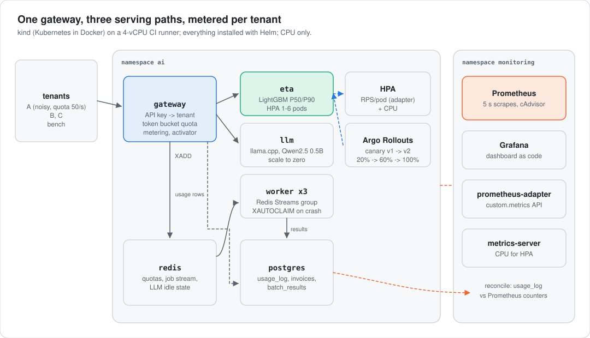
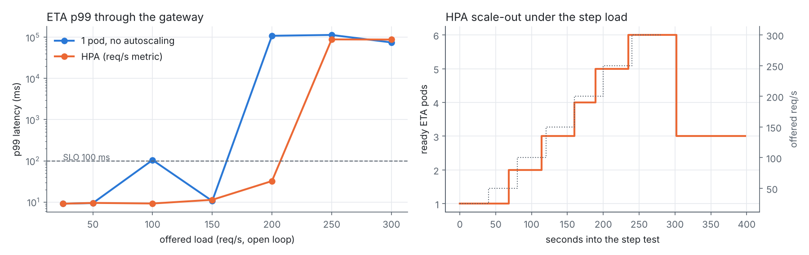

<div align="center">

# K8s AI Serving Platform

**A small multi-tenant model API on Kubernetes: API keys, per-tenant quotas, usage metering and billing, autoscaling, canary rollouts, at-least-once batch inference and an LLM that scales to zero.**
<br>Every number below was measured on a CPU-only kind cluster in GitHub Actions. No GPU was used and no GPU numbers are claimed.

[](https://github.com/Jitesh-Mishra/k8s-ai-serving-platform/actions/workflows/ci.yml)


| **200 req/s at 32 ms p99** | **0 of 6,300** | **$0.58 per 1M tokens** | **3.0 s cold start** |
|:---:|:---:|:---:|:---:|
| with the HPA (1 to 6 pods); one pod holds 150 req/s and collapses at 200 | requests mismatched between the PostgreSQL usage log and Prometheus | LLM decode on CPU (Qwen2.5-0.5B Q4, llama.cpp), at $0.0446 per vCPU-hour | LLM scale-from-zero, after scaling to zero at 45 s idle |

</div>

<picture>
  <source media="(prefers-color-scheme: dark)" srcset="docs/img/architecture-dark.svg">
  
</picture>

> **The honest summary.** Autoscaling, metering, batch recovery and scale-to-zero all work and are measured. The one thing that did not work: per-tenant quotas at the gateway capped the noisy tenant but did not protect the others. At a 120 req/s and a 200 req/s flood, tenants B and C went from about 13 ms p99 to over 70 s with quotas on or off (E2). Everything runs on one 4-vCPU runner that also drives the load, so treat absolute numbers as a contended laptop, not a cloud.

## What's in it

| Piece | What it does | Where |
|---|---|---|
| Gateway (FastAPI) | API key to tenant, Redis Lua token bucket per tenant (429 over quota), Prometheus counters, buffered async PostgreSQL usage log, scale-to-zero activator for the LLM | `aiserve/gateway.py`, `ratelimit.py`, `meter.py`, `activator.py` |
| ETA model | LightGBM P50/P90 pickup-ETA boosters from [nyc-rideshare-pickup-eta](https://github.com/Jitesh-Mishra/nyc-rideshare-pickup-eta), fed 2,000 real feature rows | `aiserve/eta.py`, `model.py` |
| Autoscaling | HPA on a custom metric, `eta_requests_per_second` via prometheus-adapter, 40 req/s per pod, 1 to 6 pods | `charts/aiserve/templates/eta.yaml` |
| Canary | Argo Rollouts, 20% then 60% then 100%, with a 10 s preStop drain on old pods | same, `rollout.enabled` |
| Batch | Redis Streams consumer group, idempotent insert `ON CONFLICT (job_id)`, then `XACK`; `XAUTOCLAIM` after 15 s idle | `aiserve/worker.py` |
| LLM | llama.cpp server, Qwen2.5-0.5B-Instruct Q4_K_M GGUF, 0 or 1 replica | `charts/aiserve/templates/llm.yaml` |
| Billing | `usage_log`, `prices`, `daily_invoice` view; reconciliation against Prometheus per pod, tenant, model and status | `aiserve/meter.py`, `bench/experiments.py` |
| Observability | kube-prometheus-stack, ServiceMonitors at 5 s, a Grafana dashboard (tenants, latency, 429/502, replicas, queue, tokens/s, CPU by service) | `charts/aiserve/dashboards/aiserve.json` |

Three tenants, each with its own API key and quota (`deploy/aiserve-ci.yaml`): A at 50 req/s (the noisy neighbour), B and C at 200 req/s. A fourth key, `bench`, has a very high quota for the capacity tests. Tenants are logical (keys, quotas, metering); they share one namespace and the same serving pods.

## Results

All experiments: `bench/experiments.py`, run by `.github/workflows/bench.yml`, raw output committed to the `bench-results` branch. Which run each file comes from: [`reports/PROVENANCE.md`](reports/PROVENANCE.md).

### E1. Autoscaling: how much load holds the SLO

Open-loop load (requests fire on schedule, no coordinated omission) through the gateway, 40 s per step. SLO: p99 at most 100 ms and under 1% errors, over the last 30 s of each step.

<picture>
  <source media="(prefers-color-scheme: dark)" srcset="docs/img/autoscale-dark.png">
  
</picture>

| Offered req/s | 25 | 50 | 100 | 150 | 200 | 250 | 300 |
|---|---:|---:|---:|---:|---:|---:|---:|
| 1 pod, p99 ms | 9.1 | 9.4 | 104.6 | 10.6 | 109,005 | 114,209 | 75,070 |
| HPA, p99 ms | 9.1 | 9.5 | 9.2 | 11.3 | **32.3** | 88,928 | 88,140 |

- Highest step within the SLO: **150 req/s on 1 pod, 200 req/s with the HPA.** The 104.6 ms blip at 100 req/s on one pod is a single bad step (p50 5.1 ms); 150 passed.
- Scale-out reaction, from a step starting to the first new pod being ready: **28 to 40 s** (5 scale-outs, 1 to 6 pods). That lag is the adapter's 30 s rate window plus pod start.
- Why one pod stops at about 150: each ETA pod has a 200m CPU limit, and at 1.1 CPU-ms per prediction (E7) 150 req/s is about 0.17 cores and 200 req/s about 0.22, over the limit. That's an inference from two measurements, not a direct throttling measurement.
- Both collapse at 250+ req/s, which is the node: 4 vCPUs shared by the ETA pods, the gateway, Redis, PostgreSQL, the monitoring stack and the load generator.

### E2. Noisy neighbour: do quotas protect the other tenants?

ETA fixed at 1 pod, no HPA. Tenants B and C send 30 req/s each. Tenant A floods with a 50 req/s quota. Gateway at 3 replicas. p99 over 50 s per phase.

| Tenant A flood | Phase | A admitted / throttled | B p99 | C p99 |
|---|---|---:|---:|---:|
| none | baseline | | 12.3 ms / 13.1 ms | 12.6 ms / 14.2 ms |
| 120 req/s | quotas on | 4,386 / 1,637 | 75.8 s | 78.4 s |
| 120 req/s | quotas off | 6,005 / 0 | 72.0 s | 77.8 s |
| 200 req/s | quotas on | 6,548 / 3,522 | 89.1 s | 93.6 s |
| 200 req/s | quotas off | 10,042 / 0 | 78.6 s | 81.8 s |

<sub>Baseline shows the 200 req/s run / the 120 req/s run. Latency is measured from each request's scheduled send time, so client-side queueing counts. `reports/e2_noisy_neighbour_flood{120,200}.json`.</sub>

- **The quota worked as a limiter and failed as isolation.** It throttled A in both runs, and B and C still went from about 13 ms to over 70 s p99. Turning quotas off made no meaningful difference.
- **The cause is not isolated yet.** With quotas on at a 120 req/s flood, the ETA pod should have seen about 110 req/s (A's 50 plus B and C's 60). A single pod held 150 req/s in E1. Each phase also ran 110 to 160 s instead of 60, so the backlog built up somewhere between the load generator, the 3 gateway replicas and the shared node. One more number matters: the ETA pod has a 200m CPU limit, and at 1.1 CPU-ms per prediction (E7) it runs close to that limit above about 150 req/s, so any extra burst gets CFS-throttled.
- **What I'd do next:** run the load generator off the node, record per-pod CPU throttling (`container_cpu_cfs_throttled_periods_total`) during the flood, and reject over-quota traffic at the ingress so a 429 costs almost nothing. Per-tenant capacity (separate pools or priority) is the real fix for isolation.

### E3. Metering and billing

| Check | Result |
|---|---|
| Requests in Prometheus vs rows in PostgreSQL, per gateway pod, tenant, model, status | **6,300 vs 6,300, 0 mismatched** |
| Gateway rolling restart during 2,000 requests | 2,000 succeeded, **0 unbilled** |
| Gateway pod SIGKILLed during 2,000 requests | 2,000 succeeded, **0 unbilled** |

- The usage log is flushed every 200 ms and on SIGTERM. A SIGKILL can lose up to one buffer; in this run nothing was lost, which shows the window is small, not that it's zero.
- The daily invoice is a SQL view: billable and throttled requests, units and amount per tenant and model (`reports/e3_metering.json`). Prices in it ($0.10 per 1K ETA rows and so on) are examples.

### E4. Batch inference survives worker crashes

3,000 jobs on 3 workers, 2 worker pods killed mid-run: **3,000 completed, 0 lost, 0 recorded twice**, 12 reclaimed from dead workers by `XAUTOCLAIM`, 53.5 s end to end.

### E5. Canary rollout, with and without a preStop drain

Argo Rollouts v1 to v2 under Locust (60 users at 1 req/s, 150 s, 5 replicas):

| | Requests | Failed |
|---|---:|---:|
| With a 10 s preStop on old pods | 9,000 | **1** (one 502) |
| Without preStop | 9,000 | 5 |

One run each, so this is a direction, not a significant difference.

### E6. LLM on CPU, and scale-to-zero

Qwen2.5-0.5B-Instruct Q4_K_M on llama.cpp, 128-token completions.

| | 1 replica | 2 replicas |
|---|---:|---:|
| Throughput, 4 concurrent requests | 50.3 tok/s | 60.2 tok/s |
| Median latency | 10.2 s | 7.5 s |
| CPU-seconds per 1M tokens | **46,806** | 64,440 |
| Dollars per 1M tokens at $0.0446 per vCPU-hour | **$0.58** | $0.80 |

- A single request decodes at a median of 50.6 tok/s. A second replica adds only 20% throughput because both share the same 4 cores, and it costs more per token.
- **Scale-to-zero:** the gateway scales the LLM to 0 after 45 s idle (measured 45.4 and 47.5 s) and back to 1 on the next request. Cold start (scale-up to llama.cpp healthy) was 2.78, 3.03 and 3.03 s, **median 3.0 s**; warm requests take about 0.8 s.
- **Idle cost avoided:** the LLM pod reserves 0.5 vCPU, so each idle hour at zero saves $0.022, **$0.54 per fully idle day**. (`e6_llm.json` reports 1.0 vCPU and $1.07; it was computed before the request was lowered to 0.5 vCPU. The chart value is the right one.)

### E7. Unit economics of the ETA model

100 req/s for 60 s, CPU-seconds per container from Prometheus (`container_cpu_usage_seconds_total`):

| Service | CPU-s per 1K predictions |
|---|---:|
| Gateway (auth, quota, metering) | 2.29 |
| ETA model | 1.107 |
| Redis | 0.17 |
| PostgreSQL | 0.135 |
| **Full path** | **3.702**, so **$0.046 per 1M predictions** |

The model is under a third of the cost. The gateway's per-request work (Python, a Redis round trip, a metering row) is the expensive part, which is where a production version would optimise first.

**Price assumption:** $0.0892/h for an AWS c7i.large (2 vCPU, on-demand, us-east-1, Linux) per [this calculator](https://calculator.holori.com/aws/ec2/c7i.large/us-east-1), checked 2026-10-30, so $0.0446 per vCPU-hour. Scale only, not a quote.

## Run it

Needs Docker, kind, kubectl and Helm.

```bash
pip install -r requirements-dev.txt && pytest -q        # unit tests + gateway against a real Redis
python bench/run_all.py                                  # kind cluster, Helm installs, all experiments, about 50 min on 4 vCPUs
```

Or in GitHub Actions: **Actions, bench, Run workflow** (inputs: gateway replicas, flood rate). Results land on the `bench-results` branch; `scripts/pull_results.sh` copies a run into `reports/`, `scripts/make_figures.py` redraws the figure.

## Limitations
- **CPU only, one node.** A 4-vCPU GitHub runner, shared with the load generator. No GPU, no multi-node scheduling, no network between nodes.
- **Gateway quotas are not isolation, and E2's cause isn't pinned down.** See E2 for what's known and the next experiment.
- **The canary comparison is n=1.** Shows the mechanism, not a statistically tested gain.
- **Cold start excludes image pull and model download.** The image is preloaded into kind and the GGUF is on a hostPath.
- **Prices are examples.** The vCPU price is a public on-demand list price; invoice prices are made up.
- **Grafana dashboard ships, screenshots don't.** Headless captures from the runner rendered panels without lines, so they aren't used here.

## Decisions
Design choices and the bugs the runs found: [`docs/decisions.md`](docs/decisions.md). Interview prep: [`docs/probe-prep.md`](docs/probe-prep.md).

---
<sub>**Stack:** Kubernetes, kind, Helm, Docker, Prometheus, Grafana, Redis, PostgreSQL, FastAPI, llama.cpp, Python, GitHub Actions, Argo Rollouts, Locust, LightGBM.</sub>
